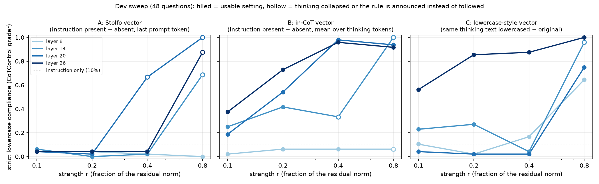
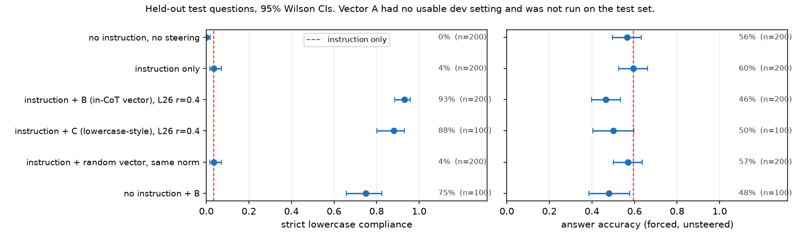

# Steering a reasoning model's chain of thought to follow a CoT instruction

Reasoning models are bad at following instructions about their *own* chain of thought. The
[CoTControl](https://github.com/YuehHanChen/CoTControl) benchmark (Chen et al., 2026, arXiv 2603.05706) measures this.
This repo asks whether **activation steering** can make Qwen3-8B follow the benchmark's `lowercase_thinking` rule
(*"You must use only lowercase letters in your reasoning stage…"*), and compares three ways of building the steering
vector. It is the minimal, self-contained version of one experiment; nothing else.

## The three vectors

All three are built from the same 300 questions (disjoint from every evaluation question), unit-normalised, and added
to the residual stream at the output of one decoder layer, scaled to r × the typical residual norm at that layer so
strengths are comparable.

| vector | how it is built | what it captures |
|---|---|---|
| **A: Stolfo vector** | residual at the last prompt token (the prefilled `<think>`), instruction present − absent. The recipe of Stolfo et al. (2024), *Improving instruction-following in language models through activation steering* (arXiv 2410.12877). | the instruction's representation |
| **B: in-CoT vector** | mean residual over the first 256 *thinking* tokens of instruction-mode traces − no-instruction traces, same questions | how thinking differs when the instruction is present |
| **C: lowercase-style vector** | mean residual over the same no-instruction thinking text, lowercased − original | writing in lowercase (a style reference, not instruction-derived) |
| random | Gaussian direction, same norm | control |

Steering is applied at every prompt position and every thinking token (the figures below). Layer and strength were
chosen per vector on a separate 48-question dev set with a rule fixed before the test run: maximise strict
compliance subject to no collapsed thinking (≤ 2/48 traces under 32 tokens), no letter-free traces, word quality and
repetition within 5–10% of the unsteered reference, and no rise in meta-mentions of the rule.

## Results

**Dev sweep (48 questions, 3 vectors × 4 layers × 4 strengths).**



- **A (Stolfo) never works.** Every setting that raises compliance does so by making the model stop thinking
  (hollow markers at r ≥ 0.4: 32–48 of 48 traces under 32 tokens) or by having it announce the rule instead of
  following it (layer 26, r = 0.8: 79% of traces mention "lowercase"). Its dev-selected setting (layer 14, r = 0.1,
  6%) is no better than the unsteered 10%, so A was not run on the test set.
- **B and C work at layer 26.** B reaches 96% at r = 0.4 with thinking intact; C 88%.

**Held-out test (200 questions for the main conditions, 100 for the secondary ones).**



| condition | n | strict compliance [95% CI] | answer accuracy |
|---|---|---|---|
| no instruction, no steering | 200 | 0% [0, 2] | 56.5% |
| instruction only | 200 | 3.5% [1.7, 7.0] | 59.5% |
| instruction + **B** (layer 26, r = 0.4) | 200 | **93.0%** [88.6, 95.8] | 46.5% (McNemar p < 0.001) |
| instruction + **C** (layer 26, r = 0.4) | 100 | **88.0%** [80.2, 93.0] | 50.0% (p = 0.39 vs 54% on the same questions) |
| instruction + random vector | 200 | 3.5% [1.7, 7.0] | 57.0% (n.s.) |
| no instruction + B | 100 | 75.0% [65.7, 82.5] | 48.0% |

Compliance is the CoTControl grader applied to the whole thinking trace: a single uppercase letter fails it.
Accuracy is measured with steering off, by forcing `ANSWER:` after the thinking and taking the most likely option letter.

**What it says.**
1. Steering *inside the thinking* raises compliance from 3.5% to 93%. A random vector of the same size does nothing.
2. The vector that works is a style push, not an "obey the instruction" signal. Stolfo's instruction-representation
   vector has no usable setting; the in-CoT vector still gives 75% with no instruction in the prompt at all; and a pure
   "write in lowercase" vector gives 88%. The instruction helps on top (93% with it vs 75% without), but the model's
   representation of the instruction is not what drives compliance.
3. At full strength it costs accuracy (59.5% → 46.5%): long traces loop. In the original study, half strength
   (r = 0.2) gave 69% compliance at no accuracy cost; that run is not included here.

## Checks (`verify_steer.py`)
Every number is re-derived from the saved token ids with the benchmark's grader. The script also reports compliance on
length-matched subsets (traces ≥ 512 tokens; the first 256 tokens of every trace), so steering that merely shortens
thinking cannot win; paired McNemar tests on accuracy; empty-trace, non-ASCII, meta-mention and topicality checks; and
two random traces per condition in `results/samples.md`.

## Limitations
One rule, one model (Qwen3-8B, bf16, T = 0.6, thinking capped at 2,048 tokens; about half the traces hit the cap in
every condition). The secondary conditions use n = 100. Vector B is not pure style: it also differs in content from C
(cosine 0.55). Lowercase is a format rule; it says nothing about controlling the *content* of a chain of thought.

## Layout and how to run
```
steer.py           vectors | run --plan dev|test | analyze     (GPU; HF generate with a forward hook on one layer)
verify_steer.py    re-derive the test metrics, figures, samples  (CPU)
plot.py            the two figures above from results/*.csv     (CPU)
common.py          question selection and prompt construction through the CoTControl repo (prompts are byte-identical)
runs/vectors.pt    the vectors (A, B, C, random) at layers 8/14/20/26
runs/dev/          the 48-question sweep, one jsonl per setting
runs/test/         the six test conditions above
results/           dev_summary.csv, dev_selection.json, test_summary.csv, test_verified.csv, figures, samples.md
data/step1_traces/ the 300-question Qwen3-8B traces (no instruction / lowercase instruction) the vectors are built from
```
```
git clone https://github.com/YuehHanChen/CoTControl.git     # the benchmark: prompts, datasets and grader (MIT)
pip install -r requirements.txt
python plot.py                                              # figures from the saved metrics
python verify_steer.py                                      # re-derive the test metrics from the saved traces
python steer.py vectors && python steer.py run --plan test && python steer.py analyze --plan test   # GPU, ~1 h on one H100
```
The step-1 traces were generated with vLLM (T = 0.6, 4,096-token thinking cap) on the 300 questions `common.select_questions()` returns.
